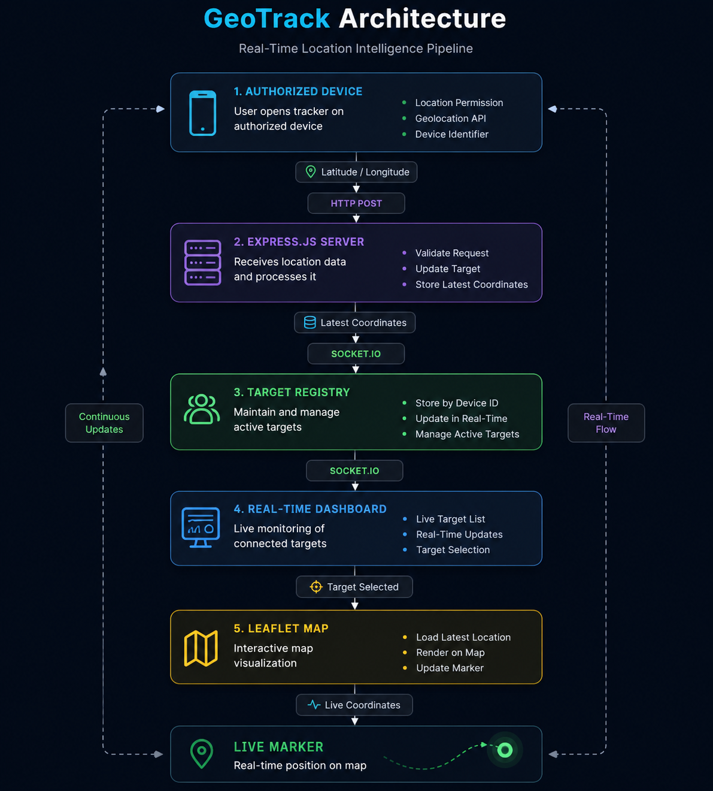
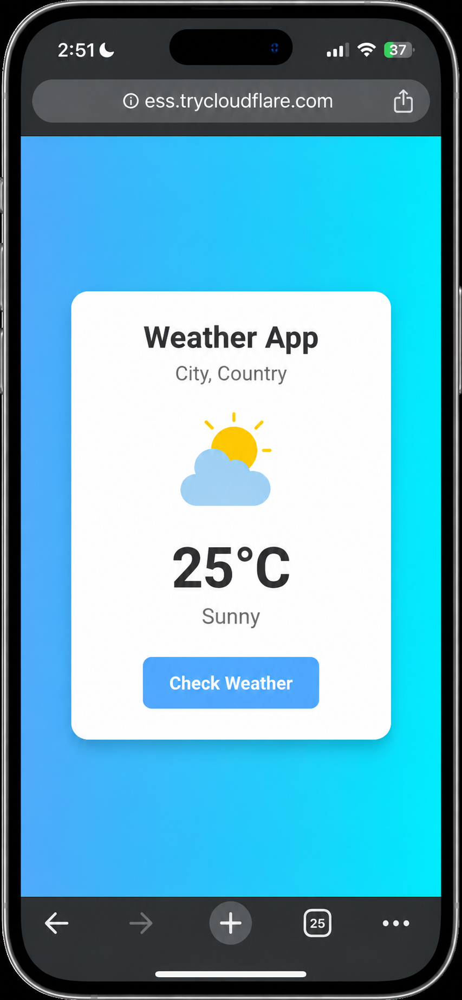
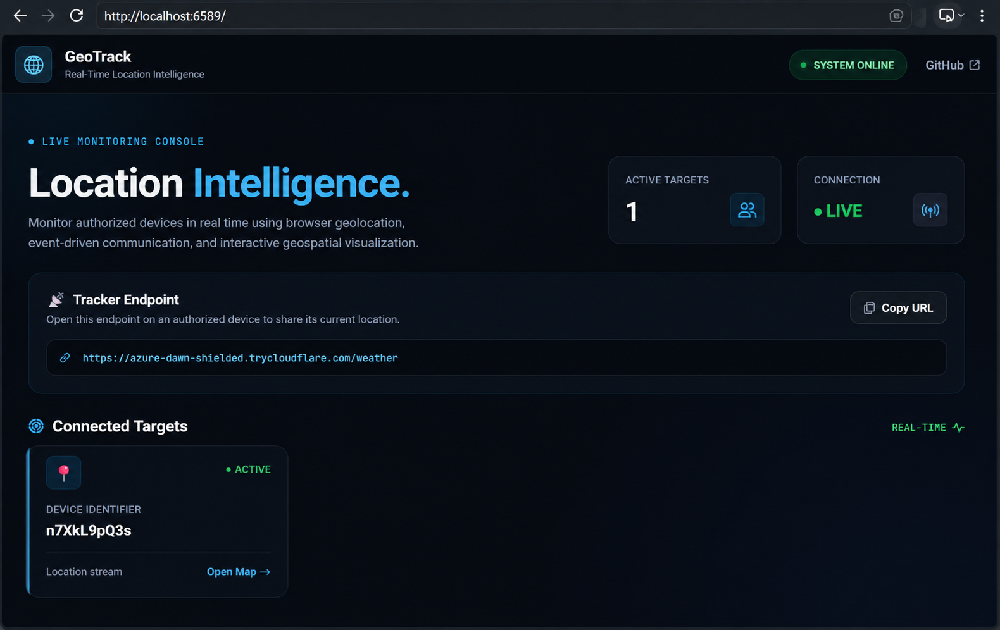
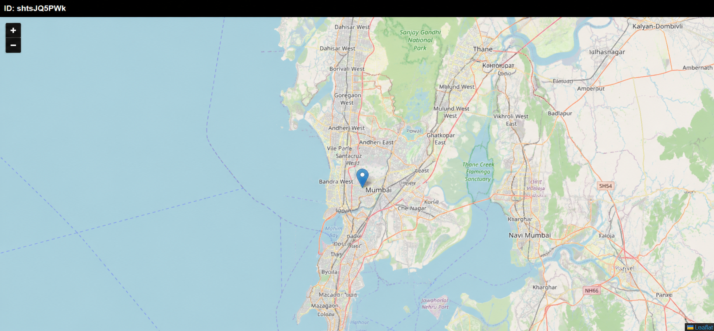

<div align="center">

# 🌐 Real-Time Location Intelligence & Tracking

### Precision Geolocation • Real-Time Communication • Interactive Mapping

<p>
  
  
  
  
  
  
  
</p>

<p>
  <strong>Capture → Transmit → Broadcast → Visualize</strong>
</p>

<p>
  A real-time geolocation platform that captures authorized device coordinates,
  streams location updates, and visualizes them on an interactive map.
</p>

</div>

---

## 📌 Overview

**Real-Time Location Intelligence & Tracking** is a lightweight real-time
geolocation platform built around the browser's **Geolocation API**.

The system allows an authorized device to share its current location,
transmits the coordinates to a Node.js backend, broadcasts updates through
Socket.IO, and displays the latest position on an interactive Leaflet map.

The project demonstrates how browser geolocation, HTTP communication,
real-time events, and geospatial visualization work together as one
end-to-end system.

---

## 🛠️ Technology Stack

| Technology | Role |
|---|---|
| **Node.js** | Backend JavaScript runtime |
| **Express.js** | HTTP server and application routing |
| **Socket.IO** | Real-time location broadcasting |
| **Geolocation API** | Obtaining device coordinates |
| **Leaflet.js** | Interactive map visualization |
| **OpenStreetMap** | Map tile provider |
| **JavaScript / HTML / CSS** | Frontend |
| **localStorage** | Client device identification |
| **Cloudflare Tunnel** | Remote access during development |

---

---
## ⚙️ How The System Works

GeoTrack follows a real-time location pipeline that moves data from an
authorized device to the monitoring dashboard and finally onto the live map.

<p align="center">
  
</p>

---

# 📱 01 — Location Sharing

The process begins when an authorized device opens the tracker and grants
location permission to the browser.

<p align="center">
  
</p>

### What happens?

1. The user opens the tracker endpoint.
2. The browser requests location permission.
3. The Geolocation API obtains the current coordinates.
4. The client generates or retrieves a device identifier.
5. Latitude and longitude are sent to the backend.

Example:

```text
Latitude  → 22.xxxxx
Longitude → 82.xxxxx
```

---

# 🖥️ 02 — Real-Time Monitoring Dashboard

Once the device sends its first location, it becomes available in the
monitoring dashboard.

<p align="center">
  
</p>

### What happens?

1. The Express server receives the location.
2. The latest coordinates are associated with the device ID.
3. Socket.IO broadcasts the new target to connected dashboards.
4. The dashboard dynamically displays the target.

> **No page refresh is required.**

---

# 🗺️ 03 — Live Location Visualization

Selecting a target opens its dedicated map.

<p align="center">
  
</p>

### What happens?

1. The dashboard opens the target's map.
2. The latest coordinates are loaded.
3. Leaflet converts the coordinates into a map position.
4. A marker represents the device's latest location.
5. New Socket.IO updates move the marker in real time.

---

# 🔄 Complete Real-Time Flow

The complete journey of a location update is:

```text
📱 Device
   │
   │ 1. Get coordinates
   ▼
🌐 Geolocation API
   │
   │ 2. HTTP POST
   ▼
🖥️ Express Server
   │
   │ 3. Update target
   ▼
⚡ Socket.IO
   │
   │ 4. Broadcast update
   ▼
🗺️ Leaflet Map
   │
   │ 5. Update marker
   ▼
📍 New Position
```

---

# 🏗️ Application Architecture

GeoTrack uses a lightweight Node.js backend with separate components for
location collection, target management, real-time communication, and
map visualization.

| Component | Responsibility |
|---|---|
| **Browser Geolocation API** | Obtains device coordinates |
| **Express.js** | Receives and processes location data |
| **Target Registry** | Maintains the latest target information |
| **Socket.IO** | Broadcasts real-time updates |
| **Dashboard** | Displays connected targets |
| **Leaflet.js** | Visualizes target locations |
| **OpenStreetMap** | Provides map tiles |

---

# ⚡ Real-Time Communication

GeoTrack uses different communication mechanisms for different stages
of the system.

| Communication | Direction | Purpose |
|---|---|---|
| **HTTP POST** | Device → Server | Sends the current location |
| **Socket.IO** | Server → Clients | Broadcasts real-time updates |
| **Leaflet.js** | Client → Map | Renders and updates the marker |

### Location Update Cycle

```text
Device
  │
  │ Location
  ▼
Express API
  │
  │ Update
  ▼
Target Registry
  │
  │ Socket.IO Event
  ▼
Connected Clients
  │
  ▼
Leaflet
  │
  ▼
📍 Updated Marker
```

---

# 📂 Project Structure

```text
real-time-location-intelligence-and-tracking/
│
├── docs/
│   └── screenshots/
│       ├── dashboard.png
│       ├── map.png
│       ├── tracker.png
│       └── workflow.png
│
├── public/
│   └── weather.png
│
├── views/
│   ├── home.html
│   ├── login.html
│   ├── map.html
│   └── weather.html
│
├── config.js
├── router.js
├── server.js
│
├── package.json
├── package-lock.json
├── .gitignore
└── README.md
```

---

# 🧩 Core Components

| File | Responsibility |
|---|---|
| `server.js` | Starts the application and manages the server |
| `router.js` | Handles application routes and location requests |
| `home.html` | Real-time monitoring dashboard |
| `map.html` | Displays the selected target on the map |
| `weather.html` | Tracker/location-sharing interface |
| `login.html` | Dashboard authentication interface |
| `config.js` | Application configuration |

---

# 🚀 Getting Started

## Prerequisites

- **Node.js**
- **npm**
- Modern web browser

Check your installed versions:

```bash
node --version
npm --version
```

## Installation

Clone the repository:

```bash
git clone https://github.com/gulshanverse/real-time-location-intelligence-and-tracking.git
```

Enter the project directory:

```bash
cd real-time-location-intelligence-and-tracking
```

Install dependencies:

```bash
npm install
```

Start the application:

```bash
npm start
```

The application will start on the configured local port.

---

# 🌐 Remote Device Testing

During development, a Cloudflare Quick Tunnel can expose the local
application through a temporary HTTPS URL.

```text
Local Server
     │
     │ localhost
     ▼
Node.js :6589
     │
     ▼
Cloudflare Tunnel
     │
     ▼
Temporary HTTPS URL
     │
     ▼
📱 Authorized Device
```

The generated public URL can change when a new Quick Tunnel session
is started.

---

# 🔐 Privacy & Responsible Use

Location information is sensitive and should be handled responsibly.

This project is intended for:

- Educational demonstrations
- Authorized device testing
- Development experiments
- Geolocation API learning
- Real-time communication research

Location access requires explicit browser/device permission.

> **Only track devices and users who have explicitly authorized
> location sharing.**

Do not use this project for covert surveillance or unauthorized tracking.

---

# ⚠️ Current Limitations

The current version is designed as a lightweight real-time prototype.

- Latest locations are maintained in server memory.
- Persistent location history is not implemented.
- Cloudflare Quick Tunnel URLs are temporary.
- Production authentication requires additional hardening.
- Production secrets should be supplied through environment variables.
- Production deployment should use HTTPS and stronger access controls.

---

# 🚧 Future Roadmap

| Planned Feature | Purpose |
|---|---|
| 📍 **Location History** | Store and replay previous positions |
| 👥 **Multi-Device Management** | Manage multiple authorized devices |
| 🗺️ **Route Visualization** | Display movement paths |
| 📐 **Geofencing** | Detect entry and exit from defined areas |
| 📊 **Location Analytics** | Speed, distance and movement statistics |
| 🔔 **Location Alerts** | Notify users about important events |
| 🔐 **Production Authentication** | Stronger identity and access control |
| ☁️ **Persistent Storage** | Securely store location data |

---

# 🎯 Project Highlights

- ✓ Browser-based Geolocation
- ✓ Real-Time Location Updates
- ✓ Socket.IO Communication
- ✓ Interactive Leaflet Maps
- ✓ Dynamic Target Discovery
- ✓ Device Identification
- ✓ Cloudflare Remote Testing
- ✓ Responsive Monitoring Dashboard
- ✓ Modular Node.js Architecture

---

<div align="center">

# 👨‍💻 Built by Gulshan Kumar

**B.Tech IT • Full-Stack Development • Real-Time Systems**

<br>

<a href="https://github.com/gulshanverse">
  
</a>

<a href="https://www.linkedin.com/in/gulshanverse/">
  
</a>

<br><br>

⭐ **If you found this project interesting, consider giving it a star.**

</div>
